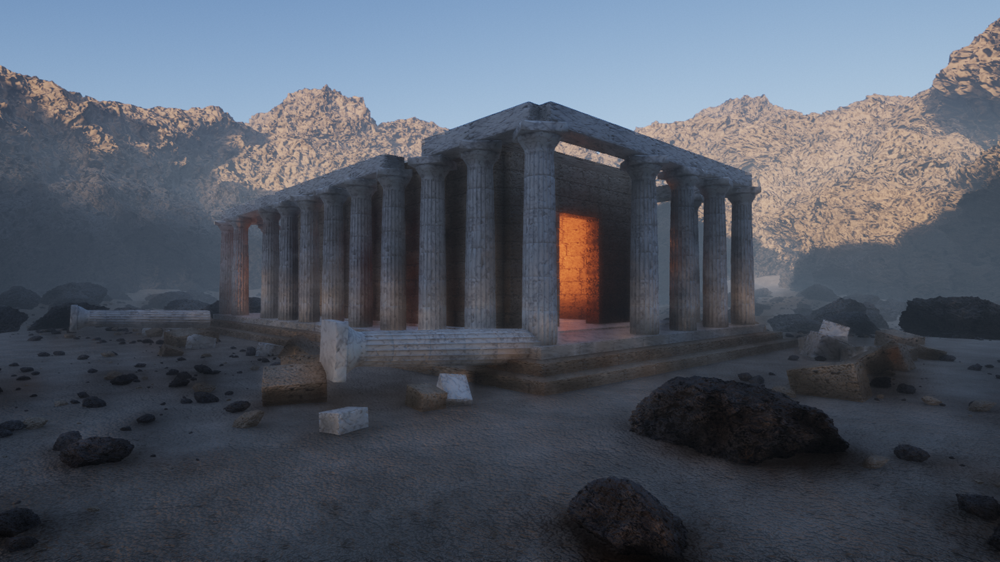
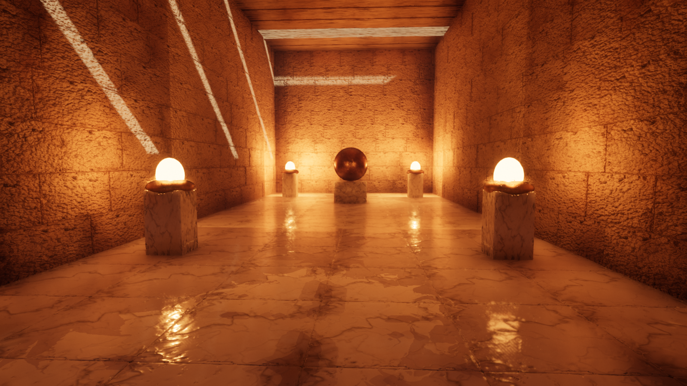
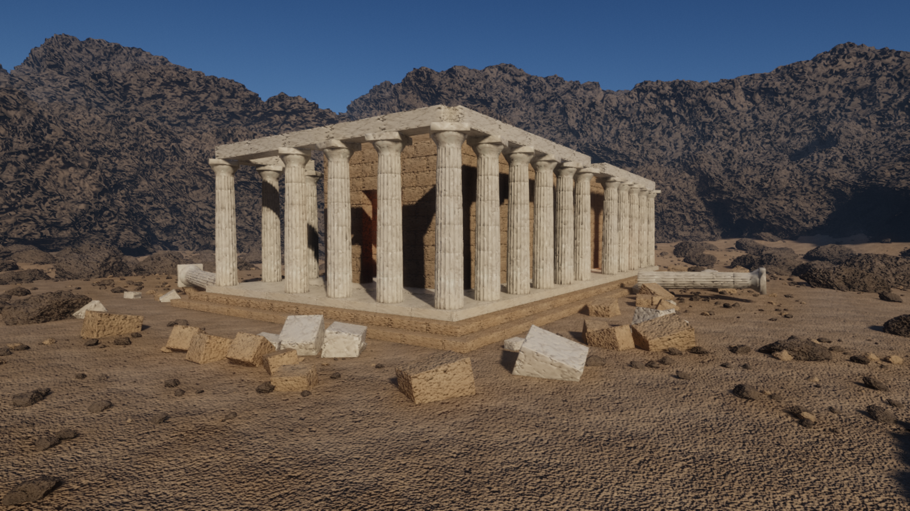
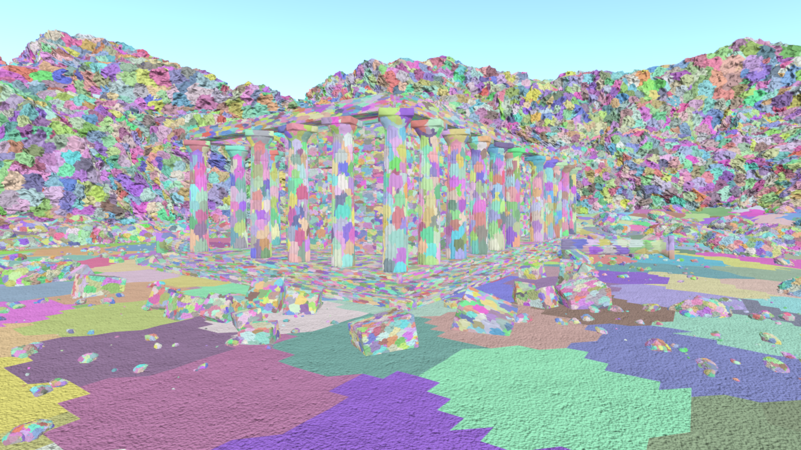

# Solstice

[](https://github.com/SamG-Coder/solstice/actions/workflows/ci.yml)
[](LICENSE)

A real-time renderer in Rust and WebGPU, built on the same core ideas as Unreal Engine 5's
Nanite and Lumen: virtualized geometry and dynamic global illumination, running in the browser.

**[Try the live demo](https://samg-coder.github.io/solstice/)** in a WebGPU browser such as Chrome
or Edge. It downloads a 67 MB scene and is demanding on the GPU.



Solstice is an independent implementation written from published techniques. It contains no
Epic Games code and is not affiliated with Epic Games.

| Multi-bounce firelight | Daylight | Cluster view |
|---|---|---|
|  |  |  |

## Quick start

```bash
cargo run --release -p bake -- --quality web --output assets/web.solstice
```

```bash
bash scripts/build-web.sh
```

```bash
python -m http.server 8765 --bind 127.0.0.1 --directory dist
```

Then open <http://localhost:8765> in Chrome or Edge.

For the native viewer, bake the full scene and run it:

```bash
cargo run --release -p bake
```

```bash
cargo run --release -p viewer
```

Both viewers use **click** to look, **WASD** to move, **Q/E** for down and up, and **Shift** to go
faster. The browser page also has controls for debug views, the sun and render scale.

## Using the library

```rust
let scene = SceneAsset { meshes, materials, instances, lights, texture_size, textures };
let mut renderer = Renderer::new(&gpu, &scene, surface_format, RendererSettings::default());

// Every frame:
renderer.render(&gpu, &camera, &environment, &output_view, output_size, delta_seconds);
```

Meshes come from `solstice_builder::build_virtual_mesh`, which runs offline. See
[`apps/bake`](apps/bake/src/scene.rs) for a complete example scene.

## How it works

```
crates/solstice-builder   Mesh -> cluster LOD DAG (offline)
crates/solstice-asset     GPU data layouts and the scene file format
crates/solstice-render    The renderer
apps/bake                 Procedural demo content
apps/viewer               Native and browser front ends
```

[`Renderer::render`](crates/solstice-render/src/renderer.rs) reads top to bottom as the recipe for
a frame. There is deliberately no render graph: every pass is a plain struct with `record`.

### Virtualized geometry

**Offline**, each mesh becomes a DAG of 128-triangle clusters: cluster, group neighbours,
simplify each group with its boundary locked, split into new clusters, repeat. Grouping changes
every level, so seams locked at one level are simplified away at the next.

**Each frame**, compute shaders walk a per-mesh hierarchy and pick a *cut* through the DAG, so that
projected error stays under one pixel. Two-phase occlusion culling tests last frame's depth, draws,
rebuilds the depth pyramid, then retests what it rejected. Small clusters go to a software
rasterizer in a compute shader, and the rest to the hardware rasterizer. Both write one visibility
buffer, which a final pass resolves to a G-buffer with analytic derivatives.

### Lighting

- **Sky:** physically based atmosphere (Hillaire 2020), with multiple scattering.
- **Sun:** four cascaded shadow maps drawn through the same culling, plus screen-space contact
  shadows.
- **Global illumination:** nearby geometry is voxelized into five clipmap levels, with a distance
  field for fast ray marching and cached radiance on each surface voxel. Those voxels gather
  light from each other over time, which gives unlimited bounces. Sparse screen probes trace into
  this volume, first through the depth buffer for contact detail, and each pixel interpolates them.
- **Reflections:** one glossy ray per half-resolution pixel: screen space, then the volume, then sky.
- **Post:** temporal anti-aliasing and upscaling, histogram exposure, bloom, ACES tone mapping.

### Where WebGPU forced a different design from Unreal

| Unreal 5 uses | WebGPU lacks it, so Solstice uses |
|---|---|
| Mesh shaders | Compute culling and instanced vertex pulling |
| 64-bit atomic visibility buffer | Separate 32-bit depth and ID buffers. Two triangles racing on a pixel can leave a one-frame wrong ID, which temporal AA hides |
| Bindless resources | Shared geometry buffers and texture arrays |
| Hardware ray tracing | Software tracing against the voxel and distance-field volume |
| Work queues that grow themselves | One dispatch per hierarchy level, over a shared queue |

## Measurements

The full scene: 26,945 instances, 8.76 billion instanced triangles, 4.5 million unique, a 203 MB
scene file, baked in about 9 seconds on a desktop CPU. Native, Vulkan, RTX 5080, 1600x900:

| View | Frame time | Triangles drawn |
|---|---|---|
| Exterior | 10.7 ms | 7.0 M |
| Dusk, from the other side | 11.3 ms | 6.6 M |
| Inside the chamber | 12.2 ms | 9.9 M |

In the browser (Chromium 152, same GPU), the 1.22 billion triangle web scene ran at 105 fps at
1024x768 with no GPU errors. **These are the only numbers measured so far.** Integrated graphics,
laptops, Safari and Firefox are untested, and the GI volume alone takes about 150 MB of GPU memory.

## Status: what this is and is not

The goal is Unreal-quality rendering in the browser. The core architecture is real and working.
The image is not yet at Unreal's level, and these are the main reasons, roughly in order of impact:

1. **Content.** Unreal's best images come from photoscanned assets. The demo is entirely procedural
   and looks it. There is no importer for real meshes yet: this is the most valuable next step.
2. **No geometry streaming.** All geometry stays resident in GPU memory, so scene size is limited
   by memory and download size, where Nanite streams pages on demand.
3. **Shadow resolution.** Cascaded shadow maps stand in for Virtual Shadow Maps, so shadows lack
   the per-pixel sharpness that makes dense geometry read properly.
4. **Static scenes only.** Moving objects are not supported: no animation, and the GI volume is
   only rebuilt when the camera moves. Previous-frame transforms exist in the data but are not fed.
5. **Surface features.** One material per instance, no translucency, no masked foliage, no
   subsurface scattering, no volumetric fog, and no material graph.
6. **GI limits.** Voxels mean thin walls can leak light, and the finest voxels are 20 cm, so small
   details get their indirect shadowing only from screen-space passes.

## Tests

```bash
cargo test --release
```

- The key property of the DAG: every LOD cut is **watertight**, at uniform thresholds and from
  perspective viewpoints that mix levels.
- All WGSL is validated without a GPU. Procedural meshes are checked to be closed and outward-facing.
- GPU tests render real frames and check for validation errors, that no pixel is missing inside a
  closed surface, and that occlusion culling skips hidden geometry. They skip themselves if no GPU
  is available.

## License

[MIT](LICENSE)
