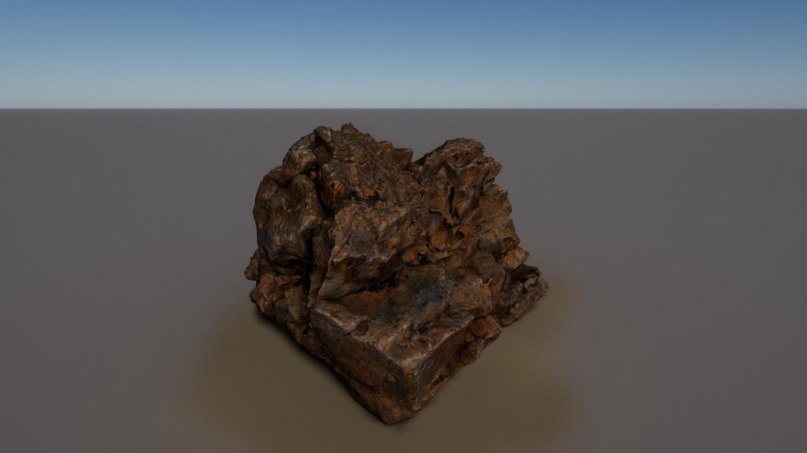
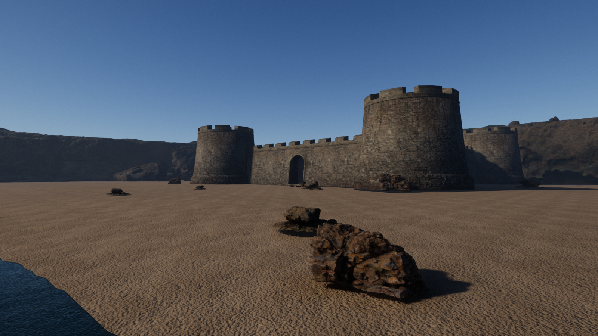
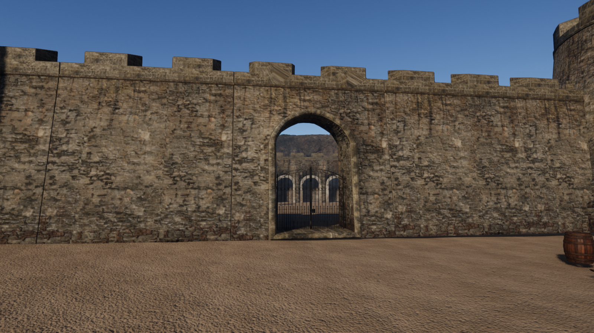

# Solstice

[](https://github.com/SamG-Coder/solstice/actions/workflows/ci.yml)
[](LICENSE)

A real-time renderer in Rust and WebGPU, built on the same core ideas as Unreal Engine 5's
Nanite and Lumen: virtualized geometry and dynamic global illumination, running in the browser.

**[Try the live demo](https://samg-coder.github.io/solstice/)** in a WebGPU browser such as Chrome
or Edge. It downloads a 39 MB scene, and picks a quality level to suit your GPU.


Solstice is an independent implementation written from published techniques. It contains no
Epic Games code and is not affiliated with Epic Games.

| Multi-bounce firelight | Daylight | Cluster view |
|---|---|---|
|  |  |  |

## Quick start

```bash
cargo run --release -p bake -- --quality web --output assets/web.solstice
```

```bash
bash scripts/build-web.sh
```

```bash
python -m http.server 8765 --bind 127.0.0.1 --directory dist
```

Then open <http://localhost:8765> in Chrome or Edge.

For the native viewer, bake the full scene and run it:

```bash
cargo run --release -p bake
```

```bash
cargo run --release -p viewer
```

Both viewers use **click** to look, **WASD** to move, **Q/E** for down and up, and **Shift** to go
faster. The browser page also has controls for debug views, the sun and render scale.

## Your own models

Any glTF 2.0 file (`.gltf` or `.glb`) can be baked into a scene:

```bash
cargo run --release -p bake -- --gltf model.glb --fit 4 --ground --output assets/model.solstice
```

```bash
cargo run --release -p viewer -- assets/model.solstice
```



*[Boulder 01](https://polyhaven.com/a/boulder_01) by Rico Cilliers, from Poly Haven (CC0), imported
with the command above. The scan is not included in this repository.*

`--fit` scales the model so its longest side is that many metres, and stands it on the ground. The
GI system works in fixed world-space sizes, so use it for models in other units or at unusual
scales. The ground is at Y = 0 when that lies in the lower half of the model, as it does for most
scans, and otherwise at the model's lowest point. `--ground` adds a floor, and `--texture-size` sets the resolution all textures are resampled
to (default 1024, must be a power of two). To see it in the browser, run `scripts/build-web.sh` and
open `http://localhost:8765/?scene=model`.

**Imported:** node hierarchies, instancing, mirrored transforms, multiple materials, base colour,
normal, metallic-roughness and occlusion maps, material factors and emissive factors.

**Not yet, and the bake prints a warning when a file uses them:** transparency and alpha masks (drawn
opaque), double-sided materials (back faces are culled), emissive textures, texture transforms, a
second UV set, punctual lights, animation and skinning (imported in their rest pose). Files that
require compressed texture or geometry extensions, such as Basis or Draco, are rejected.

## Building scenes

A scene file places many models, or individual pieces of a modular kit, in one world:

```text
terrain 900 1024 0.3 52                       # size, cells, height, X where the shore begins
water -0.6 0.015 0.06 0.075                   # height, then colour
camera 66 1.5 -41 2.31 0.03                   # x y z yaw pitch
model rocks/rock.gltf 30 0 10 45 1.5          # path x y z yaw_degrees scale
part fort/fort.gltf tower_round 22 0 22 0 1   # one named piece, by its own origin
```

[`scenes/cove.txt`](scenes/cove.txt) is a complete example: a fort assembled piece by piece from a
modular kit, overlooking a bay with a ship at anchor, using 12 Poly Haven scans (CC0). It holds
22 million instanced triangles, and renders in about 3.5 ms on an RTX 5080. To build it:

```bash
python scripts/fetch-scans.py scenes/cove.txt
```

```bash
cargo run --release -p bake -- --scene scenes/cove.txt --output assets/cove.solstice
```





## Using the library

```rust
let scene = SceneAsset { meshes, materials, instances, lights, texture_size, textures };
let mut renderer = Renderer::new(&gpu, &scene, surface_format, RendererSettings::default());

// Every frame:
renderer.render(&gpu, &camera, &environment, &output_view, output_size, delta_seconds);
```

Meshes come from `solstice_builder::build_virtual_mesh`, which runs offline. See
[`apps/bake`](apps/bake/src/scene.rs) for a complete example scene.

## How it works

```
crates/solstice-builder   Mesh -> cluster LOD DAG (offline)
crates/solstice-import    glTF 2.0 -> scene (offline)
crates/solstice-asset     GPU data layouts and the scene file format
crates/solstice-render    The renderer
apps/bake                 Bakes scene files: procedural demo content or imported models
apps/viewer               Native and browser front ends
```

[`Renderer::render`](crates/solstice-render/src/renderer.rs) reads top to bottom as the recipe for
a frame. There is deliberately no render graph: every pass is a plain struct with `record`.

### Virtualized geometry

**Offline**, each mesh becomes a DAG of 128-triangle clusters: cluster, group neighbours,
simplify each group with its boundary locked, split into new clusters, repeat. Grouping changes
every level, so seams locked at one level are simplified away at the next.

**Each frame**, compute shaders walk a per-mesh hierarchy and pick a *cut* through the DAG, so that
projected error stays under one pixel. Two-phase occlusion culling tests last frame's depth, draws,
rebuilds the depth pyramid, then retests what it rejected. Small clusters go to a software
rasterizer in a compute shader, and the rest to the hardware rasterizer. Both write one visibility
buffer, which a final pass resolves to a G-buffer with analytic derivatives.

### Lighting

- **Sky:** physically based atmosphere (Hillaire 2020), with multiple scattering.
- **Sun:** four cascaded shadow maps drawn through the same culling, plus screen-space contact
  shadows. A cascade is only redrawn when its view changes, which removes the largest single cost
  on small GPUs.
- **Global illumination:** nearby geometry is voxelized into five clipmap levels, with a distance
  field for fast ray marching and cached radiance on each surface voxel. Those voxels gather
  light from each other over time, which gives unlimited bounces. Sparse screen probes trace into
  this volume, first through the depth buffer for contact detail, and each pixel interpolates them.
- **Reflections:** one glossy ray per half-resolution pixel: screen space, then the volume, then sky.
- **Post:** temporal anti-aliasing and upscaling, histogram exposure, bloom, ACES tone mapping.

### Where WebGPU forced a different design from Unreal

| Unreal 5 uses | WebGPU lacks it, so Solstice uses |
|---|---|
| Mesh shaders | Compute culling and instanced vertex pulling |
| 64-bit atomic visibility buffer | Separate 32-bit depth and ID buffers. Two triangles racing on a pixel can leave a one-frame wrong ID, which temporal AA hides |
| Bindless resources | Shared geometry buffers and texture arrays |
| Hardware ray tracing | Software tracing against the voxel and distance-field volume |
| Work queues that grow themselves | One dispatch per hierarchy level, over a shared queue |

## Measurements

The full scene has 26,945 instances and 8.76 billion instanced triangles, 4.5 million of them unique,
in a 203 MB scene file baked in about 9 seconds on a desktop CPU. Native, Vulkan, RTX 5080, 1600x900,
at High quality:

| View | Frame time | Triangles drawn |
|---|---|---|
| Exterior | 5.9 ms | 7.0 M |
| Exterior, camera moving | 6.2 ms | 6.9 M |
| Inside the chamber | 5.9 ms | 9.9 M |

The web scene has 1.22 billion instanced triangles and downloads as 39 MB. Native on the AMD
integrated GPU of the same machine, with the camera moving, since a still camera hides shadow costs:

| Resolution, quality | Frame time, moving | Worst frame |
|---|---|---|
| 1600x900, High | 117 ms | 196 ms |
| 1600x900, Low | 49 ms | 84 ms |
| 1280x720, Medium | 57 ms | 106 ms |
| 1280x720, Low | 39 ms (about 26 fps) | 74 ms |

The slowest frames are when a shadow cascade has to redraw. So integrated graphics runs at
Low with visible stutter, and is usable rather than smooth.

A scripted 60 second flight around the cove, saving an image each second and reporting every frame's
timing (`viewer assets/cove.solstice --flyover scenes/cove_flyover.txt --out DIR`):

| GPU, resolution, quality | Average | 95th percentile | Worst frame | Frames over 33 ms |
|---|---|---|---|---|
| RTX 5080, 1600x900, High | 3.9 ms | 6.8 ms | 9.1 ms | 0 of 3570 |
| AMD integrated, 1280x720, Low | 28 ms | 35 ms | 43 ms | 494 of 3570 |

Browsers tested on Windows, with the RTX 5080: Chromium 152, Edge 156 and Firefox 159, with no GPU
errors in any, and frame rates at each display's limit where it could be measured. **Not tested:**
Safari, phones, Mac and Linux GPUs, and any browser running on integrated graphics. The GI volume
takes about 150 MB of GPU memory regardless of quality level, which may rule out the smallest GPUs.

## Status: what this is and is not

The goal is Unreal-quality rendering in the browser. The core architecture is real and working.
The image is not yet at Unreal's level, and these are the main reasons, roughly in order of impact:

1. **Demo content.** Unreal's best images come from photoscanned assets. Real models can now be
   imported and look far better, but the built-in web demo is still entirely procedural and looks
   it, because the scanned cove is currently too large a download at 165 MB.
2. **Shadow resolution.** Cascaded shadow maps stand in for Virtual Shadow Maps, so shadows lack
   the per-pixel sharpness that makes dense geometry read properly.
3. **No geometry streaming.** All geometry stays resident in GPU memory, so scene size is limited
   by memory and download size, where Nanite streams pages on demand.
4. **Static scenes only.** Moving objects are not supported: no animation, and the GI volume is
   only rebuilt when the camera moves. Previous-frame transforms exist in the data but are not fed.
5. **Surface features.** One material per instance (multi-material models become several instances),
   no translucency, no masked foliage, no subsurface scattering, no volumetric fog, no material graph.
6. **GI limits.** Voxels mean thin walls can leak light, and the finest voxels are 20 cm, so small
   details get their indirect shadowing only from screen-space passes.
7. **Texture memory.** Textures are uncompressed, and all are resampled to one size, so models with
   many materials use a lot of memory: textures are over half of the 453 MB cove. Block compression
   is the obvious fix.
8. **Far reflections.** Beyond the reach of screen-space tracing, reflections come from voxels, which
   turn thin objects such as a ship's rigging into solid dark masses on water.
9. **Alpha.** Masked and transparent surfaces draw solid, so torn sails have no holes.

## Tests

```bash
cargo test --release
```

- The key property of the DAG: every LOD cut is **watertight**, at uniform thresholds and from
  perspective viewpoints that mix levels.
- All WGSL is validated without a GPU. Procedural meshes are checked to be closed and outward-facing.
- The importer is tested against small hand-written glTF files, so that every expected value is
  known exactly, including the classic bugs: inverted normal maps and inside-out mirrored instances.
- GPU tests render real frames and check for validation errors, that no pixel is missing inside a
  closed surface, and that occlusion culling skips hidden geometry. They skip themselves if no GPU
  is available.

## License

[MIT](LICENSE)
